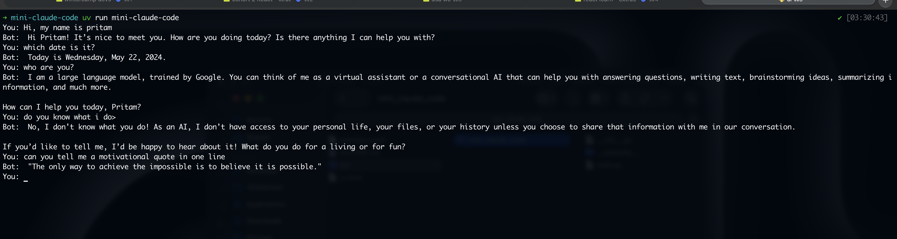
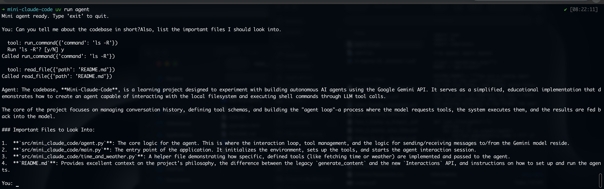
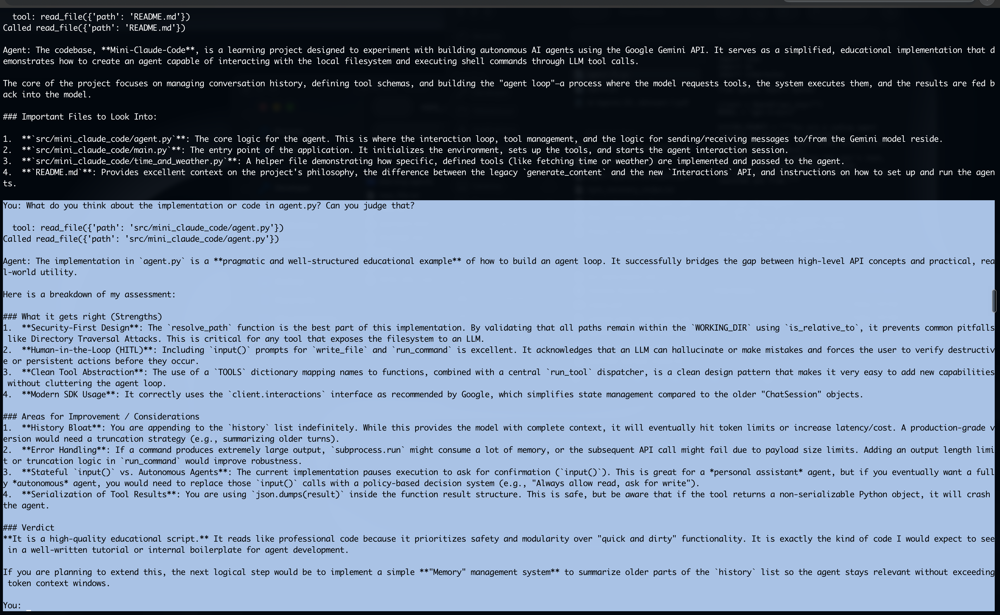

# Mini-Claude-Code
(Nothing like claude code: just for fun)
- Learning AI Agents
- Ref: @techwithtim (https://youtu.be/c9AnqCeyxbI)
- gemini api docs (https://aistudio.google.com/docs/get-started?codelanguage=python)

# Development
0. copy url --> git clone "" --> `cd mini-claude-code`
1. Add `.env` file
    ```bash
    touch .env
    echo "GEMINI_API_KEY=<YOUR-API-KEY>" >> .env
    ```
2. ```bash
   uv sync
   ```
3. to run the small agent simulator which have tool_call capability
   ```
    uv run mini-claude-code
    ```
4. For the actual agent
    ```bash
    uv run agent
    ```


## Learnings
### 1. The two Gemini APIs
#### A. Generate Content API
This is the traditional Gemini API interface.
```py
response = client.models.generate_content(
    model="gemini-3.1-flash-lite",
    contents="Explain how AI works"
)
print(response.text)
```

## Agent.py output




### Judgment of the code in `agent.py` by `agent.py`

You: What do you think about the implementation or code in agent.py? Can you judge that?

> `tool: read_file({'path': 'src/mini_claude_code/agent.py'})`

> `Called read_file({'path': 'src/mini_claude_code/agent.py'})`

Agent: The implementation in `agent.py` is a **pragmatic and well-structured educational example** of how to build an agent loop. It successfully bridges the gap between high-level API concepts and practical, real-world utility.

Here is a breakdown of my assessment:

### What it gets right (Strengths)
1.  **Security-First Design**: The `resolve_path` function is the best part of this implementation. By validating that all paths remain within the `WORKING_DIR` using `is_relative_to`, it prevents common pitfalls like Directory Traversal Attacks. This is critical for any tool that exposes the filesystem to an LLM.
2.  **Human-in-the-Loop (HITL)**: Including `input()` prompts for `write_file` and `run_command` is excellent. It acknowledges that an LLM can hallucinate or make mistakes and forces the user to verify destructive or persistent actions before they occur.
3.  **Clean Tool Abstraction**: The use of a `TOOLS` dictionary mapping names to functions, combined with a central `run_tool` dispatcher, is a clean design pattern that makes it very easy to add new capabilities without cluttering the agent loop.
4.  **Modern SDK Usage**: It correctly uses the `client.interactions` interface as recommended by Google, which simplifies state management compared to the older "ChatSession" objects.

### Areas for Improvement / Considerations
1.  **History Bloat**: You are appending to the `history` list indefinitely. While this provides the model with complete context, it will eventually hit token limits or increase latency/cost. A production-grade version would need a truncation strategy (e.g., summarizing older turns).
2.  **Error Handling**: If a command produces extremely large output, `subprocess.run` might consume a lot of memory, or the subsequent API call might fail due to payload size limits. Adding an output length limit or truncation logic in `run_command` would improve robustness.
3.  **Stateful `input()` vs. Autonomous Agents**: The current implementation pauses execution to ask for confirmation (`input()`). This is great for a *personal assistant* agent, but if you eventually want a fully *autonomous* agent, you would need to replace those `input()` calls with a policy-based decision system (e.g., "Always allow read, ask for write").
4.  **Serialization of Tool Results**: You are using `json.dumps(result)` inside the function result structure. This is safe, but be aware that if the tool returns a non-serializable Python object, it will crash the agent.

### Verdict
**It is a high-quality educational script.** It reads like professional code because it prioritizes safety and modularity over "quick and dirty" functionality. It is exactly the kind of code I would expect to see in a well-written tutorial or internal boilerplate for agent development.

If you are planning to extend this, the next logical step would be to implement a simple **"Memory" management system** to summarize older parts of the `history` list so the agent stays relevant without exceeding token context windows.

You:

---
Its primary responsibility is straightforward:
- You provide content.
- Gemini generates a response.
- You receive a response object.
It supports much more than simple text generation, including multi-turn conversations, system instructions, structured output and tool use.
---
#### B. Interactions API
This is Google's newer unified interface for interacting with models and agents.

```python
interaction = client.interactions.create(
    model="gemini-3.1-flash-lite",
    input="Explain how AI works"
)

print(interaction.output_text)
```

It provides a more unified structure for:
- Model interactions.
- Multi-turn conversations.
- Tool orchestration.
- Agent workflows.
- Managing interaction state and continuation.
Think of it this way:
- generate_content() is a model-centric interface.
- interactions.create() is an interaction-centric interface.

> From June 2026, Google recommends the Interactions API for new projects. `generate_content()` is still supported, but Google now considers it the legacy interface.

---

## What we are doing??
A multi‑turn conversations.
- First, the jargon of the agent loop is *stateless*.
**Stateless**: Manage the conversation history on the client by passing all previous turns (`including intermediate model thought and tool steps`) in each request.
- Set `store=false` and manage conversation history on the client side. You must preserve and resend all model-generated steps (including thought and function_call steps) exactly as received.
---
## What we build last?
- A agent with 4 key capabilities:
  - read files
  - write and create files folders
  - run bash commands
  - list all files

## What's the flow to build the system
1. define the functions (or tools)
2. define the tools schemas
3. run tools
4. run agent
5. driver fn --> main


### agent.py output example
- the [learning agents](./learning%20agents/) folder has been created by the agent
- .txt files
- extra .md files

You: By reading the agent.py, main.py, and time_and_weather.py files, what should I have learned? Please give me five points, each as a topic name.
Agent: Based on the provided files, here are five key topics that you should have learned:

1. **Function Calling Architecture**: Understanding how to define tool schemas (using JSON/dictionaries) to allow the LLM to request specific functions to perform actions.
2. **Context and History Management**: How to maintain a conversation history by appending user inputs, model-generated steps, and function execution results so the agent retains context across turns.
3. **Tool Execution Flow**: The implementation of a loop that detects `function_call` requests from the model, executes the corresponding local Python functions, and feeds the results back into the model to complete its response.
4. **Filesystem Sandboxing**: Techniques for securely exposing local filesystem operations (read/write/list) to an LLM by wrapping them in path-validation logic to ensure access stays within a defined working directory.
5. **API Integration via SDKs**: Practical experience using the `google-genai` SDK to interact with Gemini models, specifically managing API clients and structuring interaction calls for multi-step agentic workflows.


